# Sprint 3 - Developing a Minimum Viable Product (MVP)

## Sprint Goals

Continue to develop the web application to the point that it provides all key functionality of the system. Test and refine it so that it can serve as the basis for the final phase of development.

### Specific Goals

**Edit these goals as needed**

- Create the following web pages:
    - Home Page for browsing and searching games and posts
    - Specific pages for games and posts, displaying relevant information and other linked database information like comments, discussions and users
    - User Profile pages that display needed information for users and developers
    - Developer Dashboard for creation and control over games and posts
    - Forms to create games and posts
    - Forms to edit games and posts
- Develop SQL database queries to:
    - Retrieve specific data linked to other database tables or parameters
    - Adding dynamic data into databases, such as multiple entries linked to one thing in separate tables
    - Editing Data, and any entries related to it
    - Deleting Data, finding all linked entries and images, and deleting to not leave floating data

## Testing Search Functionality

In various parts of the web app, I plan to allow users to search results. This will mostly be for posts, but also games. To set up this system for the home page (the broadest search functionality in the app), I used a form to post the search term to the web app where I used an SQL query to find relevant entries in both games and posts.

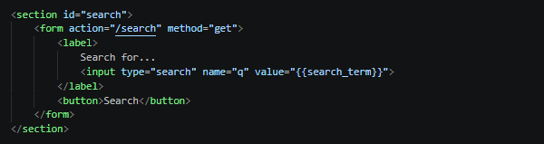

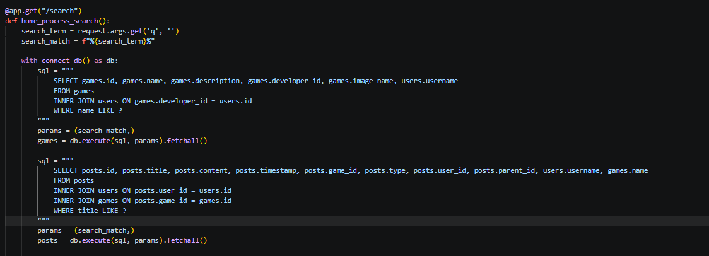

Working Search System:

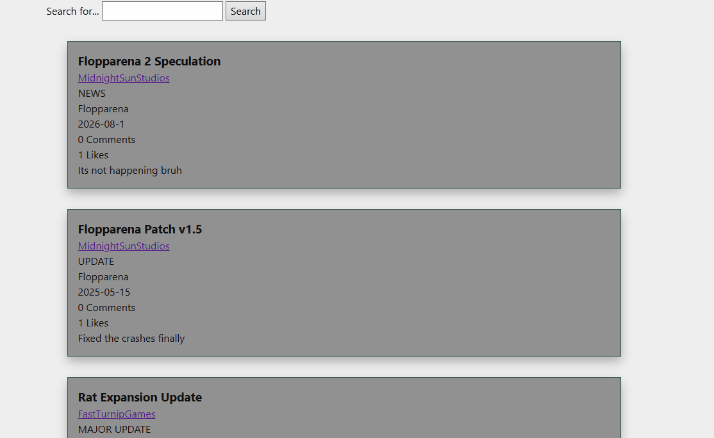

This Search system works with both games and posts, as it will find the title of the posts and name of the games that include the search query which will make it easier for users to find what they are looking for quickly instead of having to scan throw a large volume of data for something specific.

### Changes / Improvements

Testing this with an end user resulted with the feedback that users should also be able to sort the lists, whether they search or not. I implemented it as part of the search form and used the SQL order function to easily sort the data.
The three sort options I implemented were newest, oldest, and alphabetical. The alphabetical was slightly more challenging, as it needed to work with both games and posts and both have different data.
My solution to make the sort work for the different tables was a match case with the sort result.

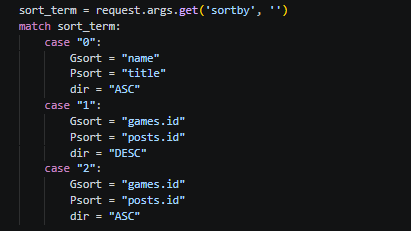

I can use SQL formatting to process these properly. End users thought this was a good improvement to the search system, and would help users find what they wanted from the app quicker, or just help them browse things they were interested in.

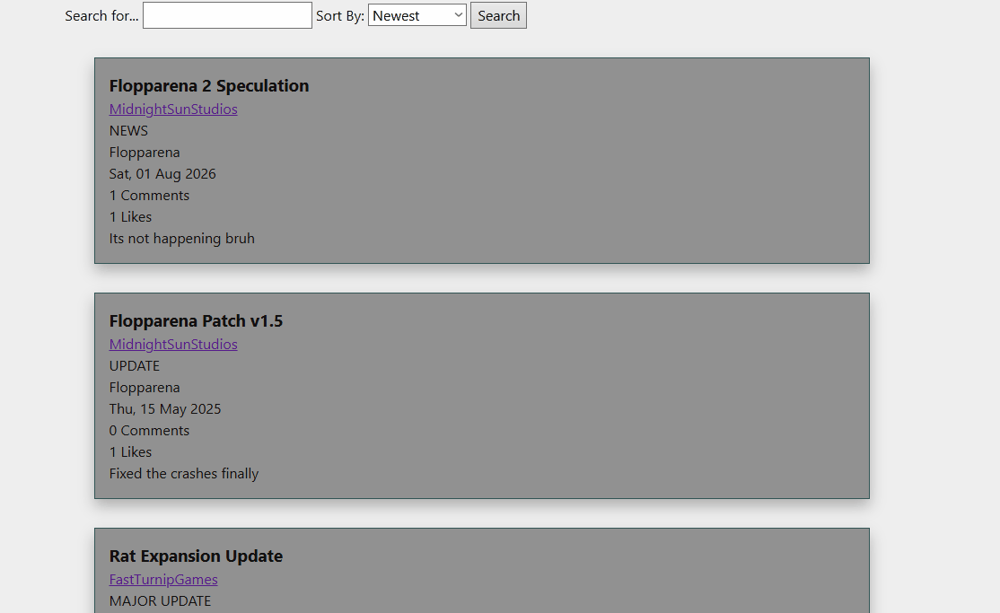

## Testing Home Page Switch

The home page is designed to show both posts and games, and with the search function working for both I needed a way to list them properly and seperately rather than just one after the other.

I created a switch that would swap the display between games and posts, using a Javascript function to swap the classes between a hidden and displayed state.

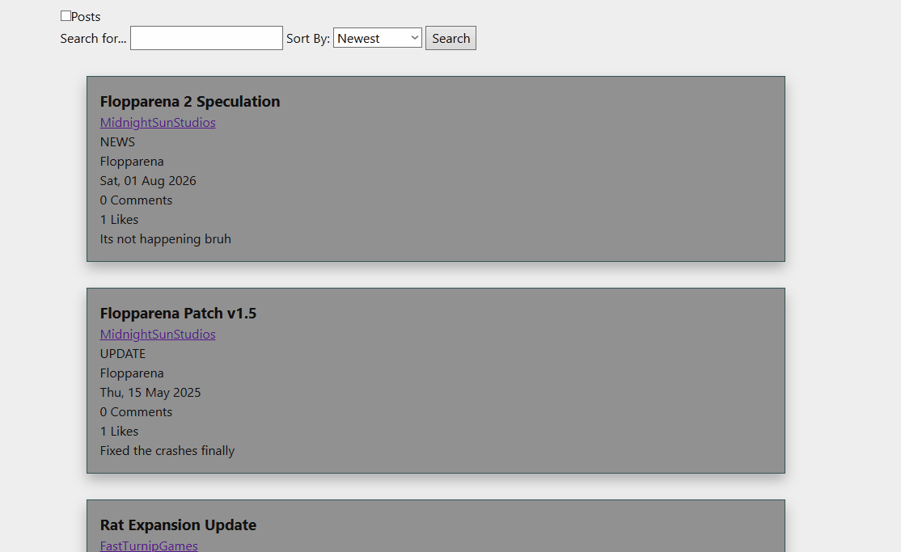

### Changes / Improvements

While testing, a bug was found when the page was reloaded, the switch would reset to its default state. To stop this, I ended up adding a Flask call that saved the switch state in the session, meaning that it would persist.

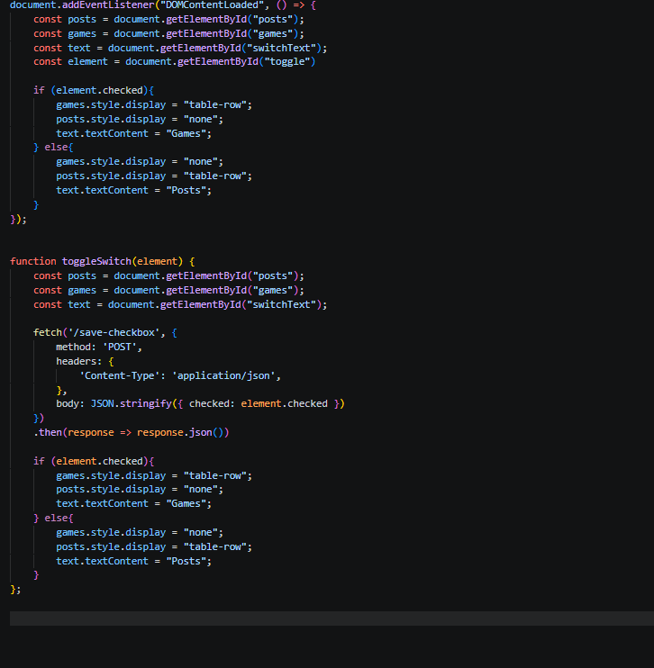

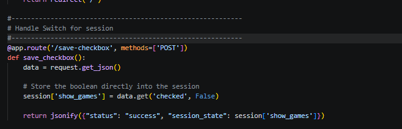

With this system, the state of the switch doesn't change when the page is opened or reloaded and is tied to the user's current session, allowing a more consistent and easier user experience.

## Testing Page State With Session

The web app has a lot of different options, depending on the state of the user. Whether they are logged out, logged in, or a developer, different things need to happen and different options to be avaliable. For this I will be testing the Navigation Menu and profile as they are primary examples of how pages change.

For the Navigation, I needed a way to display user options clearly, but as there were different numbers of them as to whether or not the user is signed in I opted to make a popup instead.

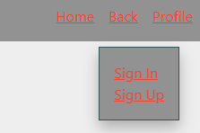
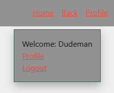
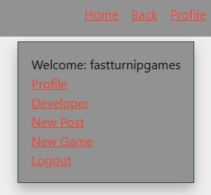

These are examples of the three states of the popup that show up for navigation, giving users only options relevant to their current user state, and restricting access to options that they shouldn't have permission or the need to use.

I also need profiles to have different states based on whether the user is the same user that the profile is for. Using the session user data and the ID of the user on the profile, I can determine if they are the same and change things based off that. With this I can display options for the user to edit or delete their profile, and the option to unfollow the games they follow which are listed on the profile.

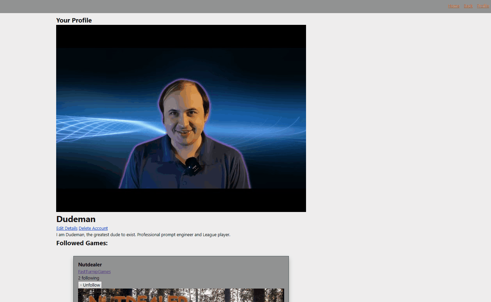

This shows the user options when looking at their profile while signed in, vs when logged out or as another user.

### Changes / Improvements

End user feedback was positive on the popup for the Nav menu, keeping it clean while still being simple, and that theres not really anything to improve there, but that developers should have further distinct profiles, that display games they've made.

I made a title above a profile if it is a developer account, and changed it from displaying followed games to games that have been created by the developer.

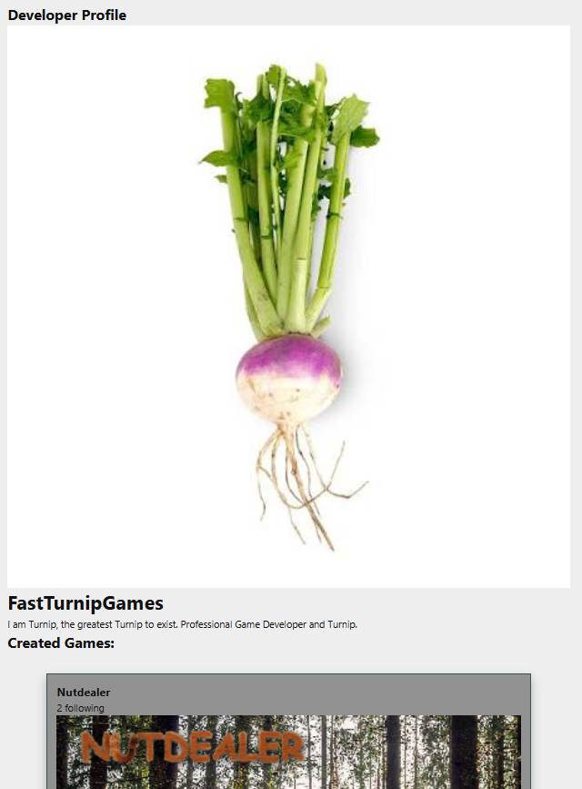

This new version of the profile makes it more distinct from standard users by listing a title, making it clearer to users whether they are a developer or not, and listing games that they've made instead of followed games adds another way that users can look for games by doing it through the developer.

## Testing Dynamic Forms

Replace this text with notes about what you are testing, how you tested it, and the outcome of the testing

**PLACE SCREENSHOTS AND/OR ANIMATED GIFS OF THE TESTING HERE**

### Changes / Improvements

Replace this text with notes any improvements you made as a result of the testing.

**PLACE SCREENSHOTS AND/OR ANIMATED GIFS OF THE IMPROVED SYSTEM HERE**

## Testing Editing Forms and Games

Replace this text with notes about what you are testing, how you tested it, and the outcome of the testing

**PLACE SCREENSHOTS AND/OR ANIMATED GIFS OF THE TESTING HERE**

### Changes / Improvements

Replace this text with notes any improvements you made as a result of the testing.

**PLACE SCREENSHOTS AND/OR ANIMATED GIFS OF THE IMPROVED SYSTEM HERE**

## Testing Deletion of data

TESTING DELETION CASCADED BLAH BLAH BLAH also confirms before deleting heavy data like game, post account, also account and game have to be deleted from certain places rather than anywhere for higher security

**PLACE SCREENSHOTS AND/OR ANIMATED GIFS OF THE TESTING HERE**

### Changes / Improvements

Replace this text with notes any improvements you made as a result of the testing.

**PLACE SCREENSHOTS AND/OR ANIMATED GIFS OF THE IMPROVED SYSTEM HERE**

## Testing Site Security and Navigation

Replace this text with notes about what you are testing, how you tested it, and the outcome of the testing

**PLACE SCREENSHOTS AND/OR ANIMATED GIFS OF THE TESTING HERE**

### Changes / Improvements

Replace this text with notes any improvements you made as a result of the testing.

**PLACE SCREENSHOTS AND/OR ANIMATED GIFS OF THE IMPROVED SYSTEM HERE**

## Sprint Review

Replace this text with a statement about how the sprint has moved the project forward - key success point, any things that didn't go so well, etc.

