# Sprint 3 - Developing a Minimum Viable Product (MVP)

## Sprint Goals

Continue to develop the web application to the point that it provides all key functionality of the system. Test and refine it so that it can serve as the basis for the final phase of development.

### Specific Goals

**Edit these goals as needed**

- Create the following web pages:
    - Home Page for browsing and searching games and posts
    - Specific pages for games and posts, displaying relevant information and other linked database information like comments, discussions and users
    - User Profile pages that display needed information for users and developers
    - Developer Dashboard for creation and control over games and posts
    - Forms to create games and posts
    - Forms to edit games and posts
- Develop SQL database queries to:
    - Retrieve specific data linked to other database tables or parameters
    - Adding dynamic data into databases, such as multiple entries linked to one thing in separate tables
    - Editing Data, and any entries related to it
    - Deleting Data, finding all linked entries and images, and deleting to not leave floating data

## Testing Search Functionality

In various parts of the web app, I plan to allow users to search results. This will mostly be for posts, but also games. To set up this system for the home page (the broadest search functionality in the app), I used a form to post the search term to the web app where I used an SQL query to find relevant entries in both games and posts.

Working Search System:

This Search system works with both games and posts, as it will find the title of the posts and name of the games that include the search query which will make it easier for users to find what they are looking for quickly instead of having to scan throw a large volume of data for something specific.

### Changes / Improvements

Testing this with an end user resulted with the feedback that users should also be able to sort the lists, whether they search or not. I implemented it as part of the search form and used the SQL order function to easily sort the data.
The three sort options I implemented were newest, oldest, and alphabetical. The alphabetical was slightly more challenging, as it needed to work with both games and posts and both have different data.
My solution to make the sort work for the different tables was a match case with the sort result.

I can use SQL formatting to process these properly. End users thought this was a good improvement to the search system, and would help users find what they wanted from the app quicker, or just help them browse things they were interested in.

## Testing Home Page Switch

The home page is designed to show both posts and games, and with the search function working for both I needed a way to list them properly and seperately rather than just one after the other.

I created a switch that would swap the display between games and posts, using a Javascript function to swap the classes between a hidden and displayed state.

### Changes / Improvements

While testing, a bug was found when the page was reloaded, the switch would reset to its default state. To stop this, I ended up adding a Flask call that saved the switch state in the session, meaning that it would persist.

With this system, the state of the switch doesn't change when the page is opened or reloaded and is tied to the user's current session, allowing a more consistent and easier user experience.

## Testing Page State With Session

The web app has a lot of different options, depending on the state of the user. Whether they are logged out, logged in, or a developer, different things need to happen and different options to be avaliable. For this I will be testing the Navigation Menu and profile as they are primary examples of how pages change.

For the Navigation, I needed a way to display user options clearly, but as there were different numbers of them as to whether or not the user is signed in I opted to make a popup instead.

These are examples of the three states of the popup that show up for navigation, giving users only options relevant to their current user state, and restricting access to options that they shouldn't have permission or the need to use.

I also need profiles to have different states based on whether the user is the same user that the profile is for. Using the session user data and the ID of the user on the profile, I can determine if they are the same and change things based off that. With this I can display options for the user to edit or delete their profile, and the option to unfollow the games they follow which are listed on the profile.

This shows the user options when looking at their profile while signed in, vs when logged out or as another user.

### Changes / Improvements

End user feedback was positive on the popup for the Nav menu, keeping it clean while still being simple, and that theres not really anything to improve there, but that developers should have further distinct profiles, that display games they've made.

I made a title above a profile if it is a developer account, and changed it from displaying followed games to games that have been created by the developer.

This new version of the profile makes it more distinct from standard users by listing a title, making it clearer to users whether they are a developer or not, and listing games that they've made instead of followed games adds another way that users can look for games by doing it through the developer.

## Testing Dynamic Forms

Some forms need to have dynamic inputs that users can control, the main examples of this are the game where users can upload multiple screenshots, and the post where I want to allow users to format their content.
Being able to upload multiple screenshots wasn't very complicated, as I could use the in built multiple file input, and get them as a list to handle normally.
For the post form, as I wanted rich text on top of images, I opted to import a Rich Text Editor Library, Trix, and implement that into the post form. As trix saves the rich text as html i set up a sanitiser to restrict the tags and ensure the html is safe before uploading. The post form also has a multiple image system similar to the game form.

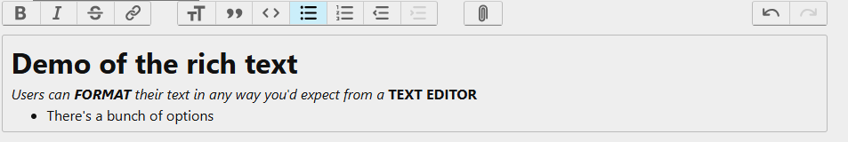
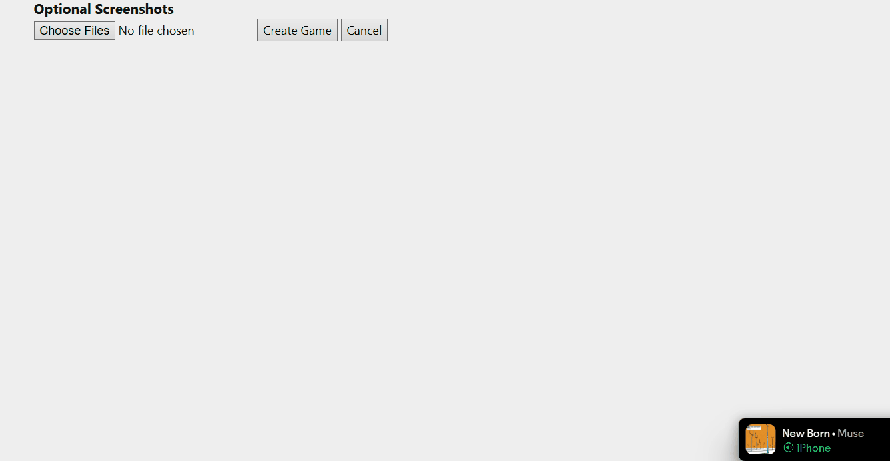

Both of the Rich text form and multiple file uploads

### Changes / Improvements

I tested these with end users, and I got some feedback on the forms. For posts, end users wanted to be able to put images throughout the text rather than a list before the actual content, and users also thought applying the optional multiple inputs to store links, to allow developers to link their game to multiple store pages if they have them.

Trix has a file uploading system, so using that and setting up flask routes, I can allow users to embed images directly into the rich text where they want, while it will save into uploads and be properly processed. For this I set up a system restricting the file types to a few common image types, and optimising and limiting the size of the files.

Using Javascript to create and remove child inputs for store links, I could make a list of links, for this to work in the database I would have to create a separate links table to allow multiple to one for the games.

Image formatting for trix, but set up to work with any image input such as profile pictures
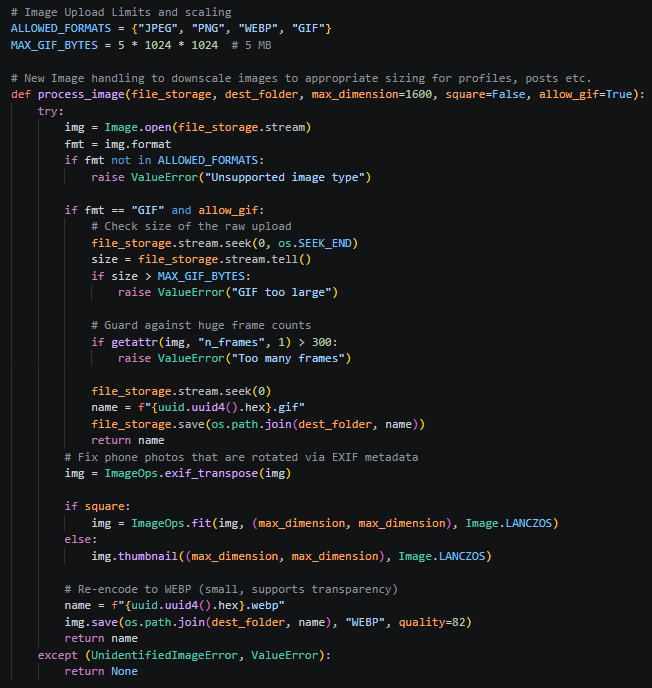

Dynamic Link creation via js
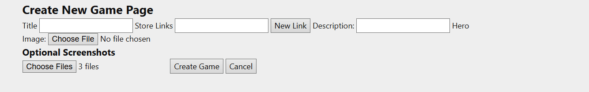

End users thought that the way of using images through Trix allowed easier control of images in posts, and thought that the dynamic link creation was good but should be restricted to a certain number, as there are usually only a few store pages. For this I just added a counter to the Javascript and limited the link count to 6, giving a reasonable maximum that should allow all developers to list every store page link.

## Testing Editing Forms and Games

Intially I had a simple edit form that retrieved the entry data from the database fed that into a form an allowed the user to change the details before updating, however this system wouldn't work with the dynamic parts of the creation, like the store links and trix rich text. 
For Trix, it wasn't much more complcated as I only had to format it to display in the trix text area, but for the links I had to create more functions to add and count the links to display and allow developers to edit them properly.

Form filling with current data and allowing users to edit, add or remove dynamic parts of form.

### Changes / Improvements

When showing to end users, the feedback on the game form was that the system I used for single images, like profile and game hero image wasn't great for the list of screenshots. The system displayed the current images, and allowed the user to choose new ones. If they submitted new images then they would replace the current ones, otherwise it would keep the old ones. With this, developers would need to re upload the old ones as well as any new ones if they wanted to just add more images.

I implemented a similar system for the screenshots that I did with the links, of listing them and allowing users to remove one by one. Using a hidden input I can retrieve the the image files that are submitted and compare them to the ones that were saved before the edit saving the overlap and new ones.

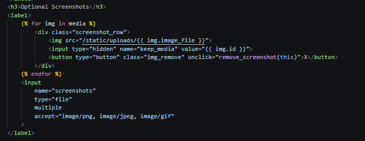

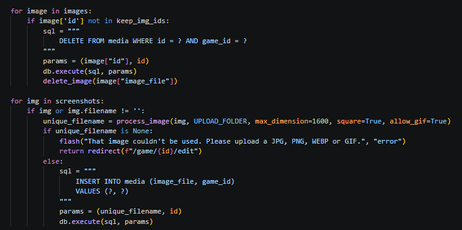

This new system allows developers to remove images they want, keeping others and adding new ones without overwriting previous ones.

## Testing Deletion of data

Due to the nature of my web app, most of the data is in some way connected to to eachother, making deleting data likely to leave hanging entries in other tables. My intial idea for deleting data was to search tables for linked data and also delete those, but I found a faster way directly in SQL which is Cascade deletion that can be set on foreign keys, removing linked data from tables with parents automatically. Though it requires some SQL config to enable.

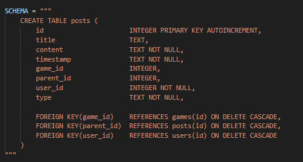

I caught a bug with Trix, as images names are saved in the content rather than a table, its much harder to find and delete images from the uploads and my current system would delete them. In posts, before deleting the entry, I would find images in the content and find the actual file route and remove that. This bug also occurred if an image in the trix form was removed while editing a post's contents, so I compared and remove images the same way when updating posts.

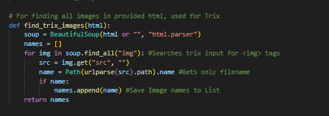

I also added a Javascript popup, making users confirm before deleting anything to add accident prevention.
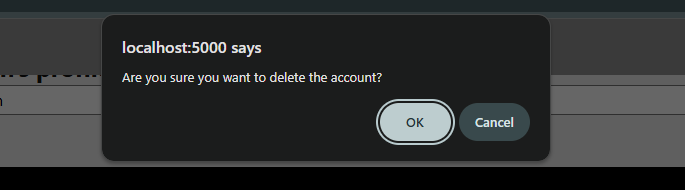

### Changes / Improvements

Most things can be deleting form whatever page its from, for example users from their profile, games from their page. End users thought that for added security to avoid accidental deletion, important data like games and users should only be able to be deleted through the edit page, reducing the chance of accidents even further.
Doing this was simple, and just required moving the deletion buttons into the edit form and removing them from other places.

## Testing Site Security and Navigation

In specific routes such as creating, editing and deleting data, and user specific pages like the developer dashboard, I needed to implement some security to stop any users, signed in or not to access these routes. 
The first security I implemented was an @login_required to routes that should only be accessed by a user with an account. I also added a check to compared session user to the owner of the entry being changed or deleted and a check for if the user is a developer before accessing developer routes.

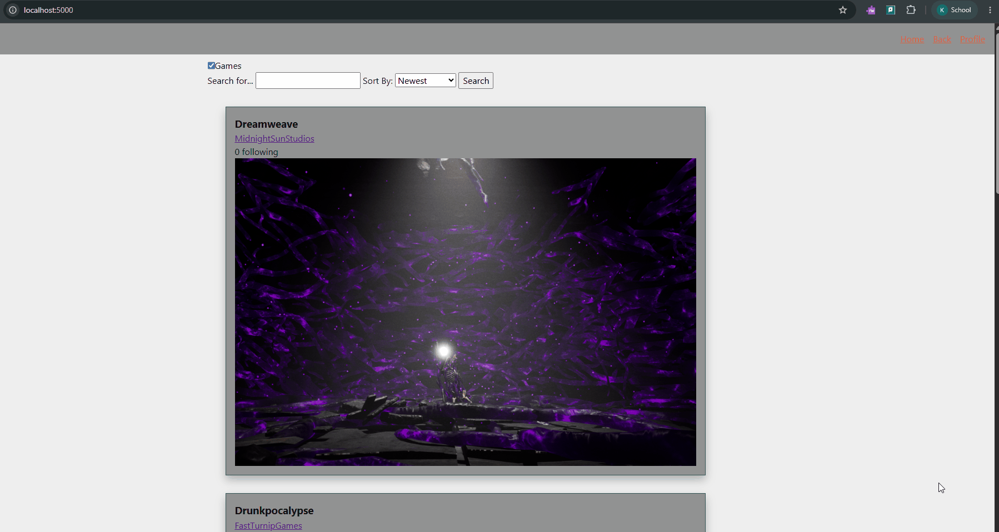

I also implemented a back button in the nav, in which I can set a url per jinja template to return to on clicked, providing users with a global way to simply navigate the site.

### Changes / Improvements

End users tested the security and it worked, stopping users from doing actions or acessing pages and routes they shouldn't be able to or would throw errors. However, the back button only rerouted if a back url was provided, and end users thought that there should be a fallback.
I added a check that if no back url was provided, it would fall back to attempting a request.refferer which is the same as the url back arrow and if that also fails then it will redirect to the home back.

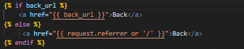

## Sprint Review

The functionality, as well as the testing with end users has resulted in a dynamic and robust app. It is usable and not complicated, giving users back option, helping prevent errors and accidents and providing users with a non confusing application that will allow a wide variety of users to make use of the web app and reach the goal they may have using the system.

