# Sprint 4 - Developing a Refined and Complete System

## Sprint Goals

Develop the system until it is fully featured, with a refined UI and it satisfies the requirements. The system will be fully tested at this point.

### Specific Goals

**Edit these goals as needed**

- Refine the design and UI of the website
- Refine the user experience (UX) of the system
- Perform final, full-system testing

testing screenshots, from row to stack
testing post on game list, so they dont go on forever if there heaps
show/hide comment replieas
dev accounts dont need to follow
testing user experience, button hover animations etc for clear design and usabitlity

## Testing HTML Validation

Prior to end user testing, I wanted to ensure my HTML was validated and efficient. I ran each page through the W3C validator to check that the web page was following standard HTML that wouldn't throw errors, and wouldn't break on some devices or browsers to ensure that the most hardware and software will be able to access the web app.
In general, there were very few errors that the validator found throughout the pages. I had alt tags on most images already, and the few icon alt tags I had missed were easy to fix. Some buttons were an a tag wrapping a button, to give link functionality to a button, though this isn't allowed and I fixed them by moving the button styling onto links, and removed the button tag making an identical button using only an a tag.
There was also an issue with nested lists with the commenting and reply system, which was solveable by restructuring the comments display to better fit the space and fit with the standard HTML formatting

Some of the ways trix handles its content doesn't work well with my site, throwing errors in the validator.

The first error is caused by the way trix handles images, as it wraps them in an a tag that links to the image which causes the error to be thrown. The other two are from the trix content formatting titles as h1, which breaks the flow of the web page and clashes with other headings, throwing more errors.

### Changes / Improvements

I changed the smaller errors such as missing alts, button wrappers and comment hierarchies, fixing the errors. However the way trix works means I can't eaily change the way it structures without hugely overwriting the library. The ways I attempted to find ways around this didn't work well, so I ended up moving on from trying to fix the error as it wasn't one I had created.

I ended up returning to this error, and with some research into trix, I discovered that the HTML parser plugin I was already using to find the images in Trix text, Beautiful Soup, could also make changes to the HTML and I could use it to remove the a tag wrapper from images, and change the heading size down from h1. I ended up turning this into a Jinja filter that I can use where trix text is displayed to format it better for my web app and stop the errors from occuring.

## Testing Mobile Formatting

To maximise accessibility, I wanted my website to work with mobile devices to make it portable and accessible anywhere, rather than just on a laptop or PC. Throughout the UI design of the web app, I changed formatting for mobile, using the @media function with width to reformat the site at smaller sizes. The majority of the formatting came down to changing the minimum widths an object can be at those smaller sizes, allowing the content to fit in the screen. I also changed how the navigation bar is formatted on mobile, moving it to the bottom of the screen and changing the buttons to be more mobile friendly, fitting with more typical mobile apps, making the web app more comfortable and familiar for users.

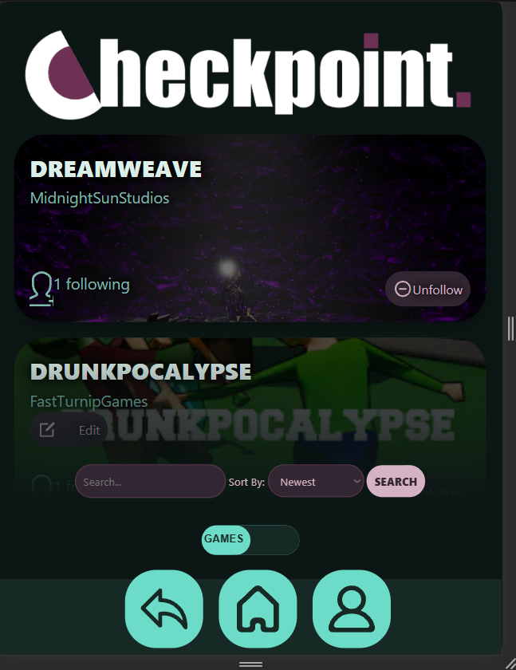
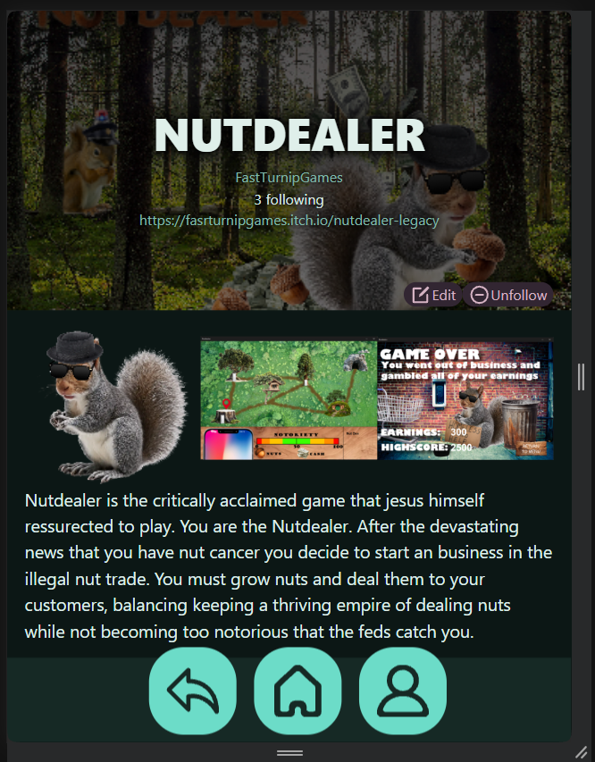

### Changes / Improvements

When testing this with end users, they tried on various screen sizes to see compatibility, and found the a few older, smaller devices didn't work correctly with the current system. The this is because at the smaller width, the shrinking of width wasn't on its own enough to fit within the website without breaking or formatting poorly. Another issue was the popup for the profile button on the nav, not being sized or positioned correctly for the device. 

I went back through, fixed the menu popup so that it more comfortably fit on the smaller screens and worked with the different widths. The content cards (Game and post displays) were the biggest scaling issue on smaller devices like, so I went through and added formatting to make it work on smaller devices. I was testing on an Iphone SE screen size, which is smaller than most screens that users will be likely to use, meaning the web app would be more accessible. The fixes for the smaller devices were a lot of reducing font size with the screen to take up less room when they don't need to, as well as moving some elements around and changing the way others are displayed to reduce unused space while still keeping the screen uncluttered and readable.

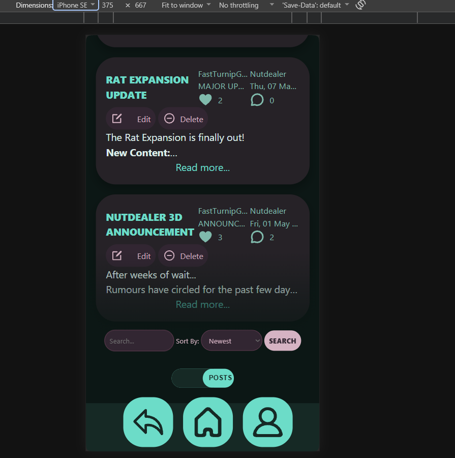
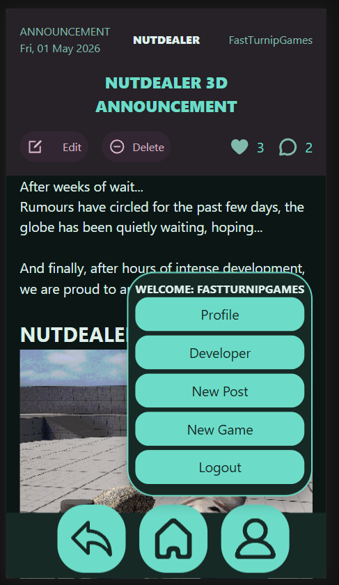

## Testing Content Cards

End users noticed that some of the separate links within the cards spanned a lot more of the space they needed to, making the cards uncomfortable to interact with, as users are more likely to accidentally click on them. The worst example end users found was the profile link on game cards, which spans the whole card and is in a spot where it gets clicked on accidentally a lot. Another spot is the game page, where links on the heading span the entire page.

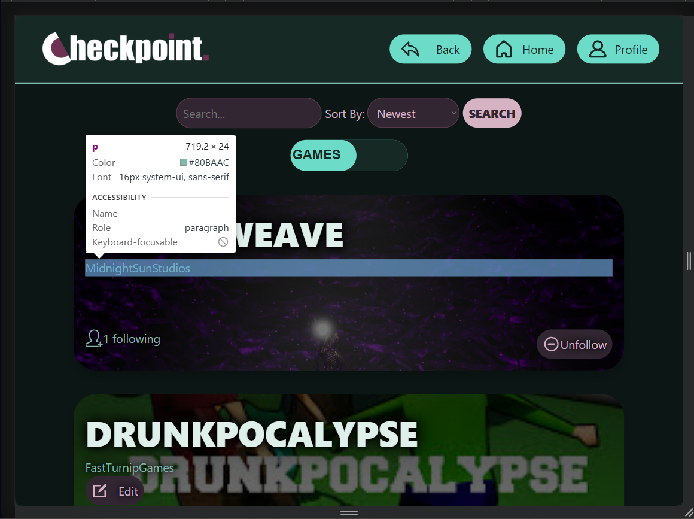

### Changes / Improvements

Fixing these issues were simple and just involved setting the width of the links to the content. This made it a ot less likely for users to accidentally click on the link without meaning to.

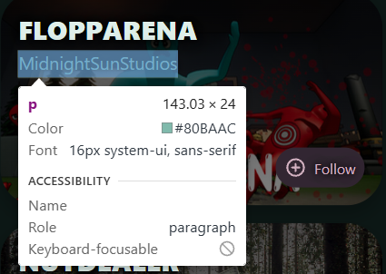
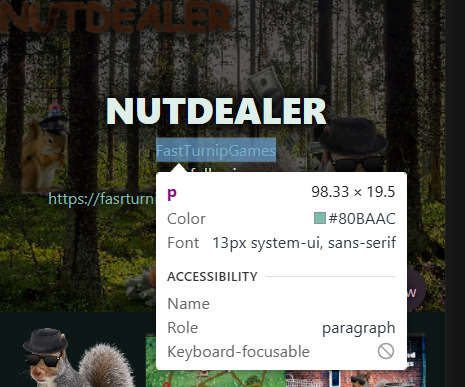

## Testing Game Screenshots

While testing the game page with my end users, one part of the feedback came down the the screenshots that developers can upload to the game. Currently they display along the page under the heading, and the width is determined by the number of images. This worked for the seed data, the the most screenshots in a game page was 3, so the images were easy to see properly on web, and still were acceptable on mobile. However, end users pointed out that at higher numbers of screenshots the images would quickly become too small to see properly, and as a lot of developers tend to upload around 10 screenshots for their games on platforms like steam, it needs to support more screenshots properly while still being readable and staying uncluttered for users.

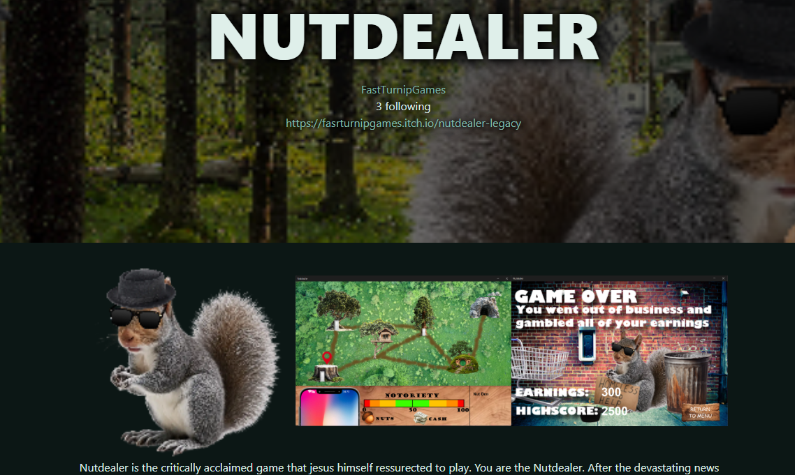

### Changes / Improvements

To make the screenshots more readable, my inital thought was to make a hover animation that zooms in the image so that users can easily look at the screenshots.

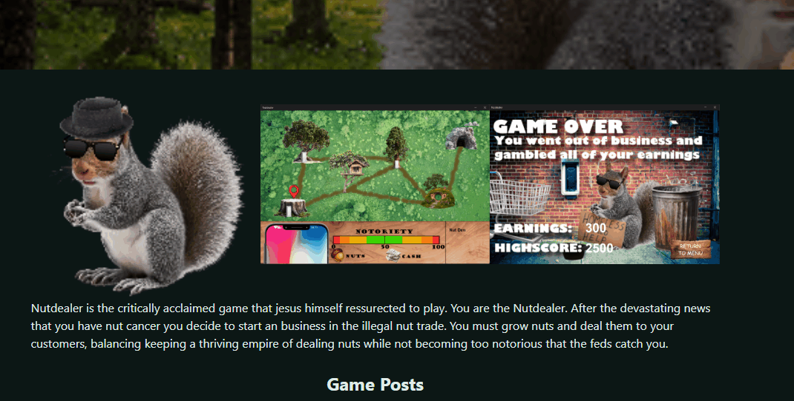

This system worked on web decently, but was still awkward as it rearranged the rest of the page content beneath it. End users thought this wasn't a great solution, and also found that it works poorly on mobile as those devices can only 'hover' if the element is focused from a user tapping on it. The width change also didn't work great on mobile.

Instead I tried to make an image carousel sort of system where one image would be focused and the others could be flicked through, making it work better on both mobile and web and not moving the page around. I ended up using the Javascript Library, Splide which allows for modular, customisable image stacks and carousels.

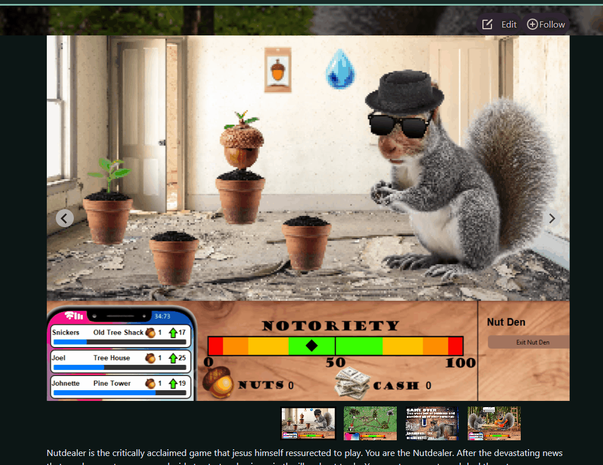

When implemented, it worked much better than the other system, and would function with any number of screenshots. End users thought this was a much bettter system, and it has native mobile support with swiping.

## Testing Game Posts

Game posts currently display as a list down the game page. End user's suggested to change how posts are displayed, as if a game has a long history of posts, the list would go on forever stopping users from easily being able to access the user discussions below. 

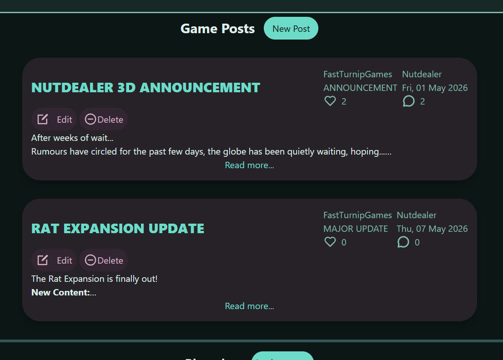

### Changes / Improvements

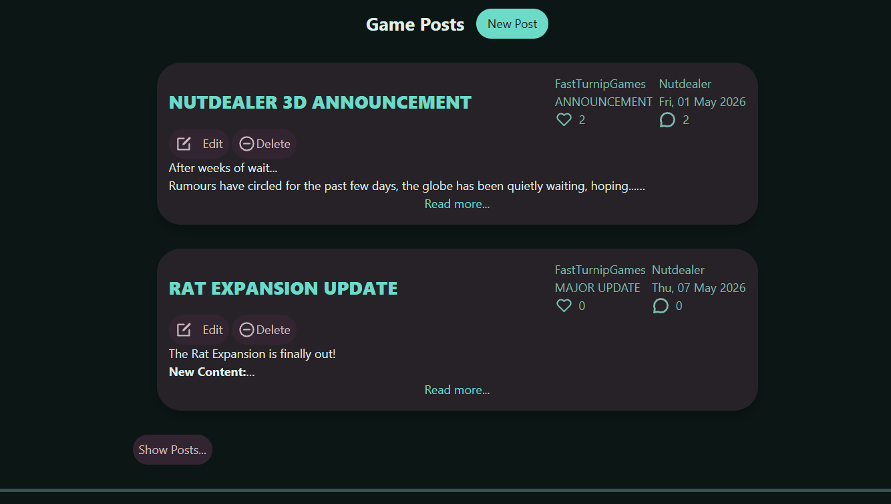

I made the posts only display the top two posts and then a button to open the rest of the list. This would allow users to keep up to date on the most recent few posts, while giving them the option to browse the rest if needed. End users thought that while this was an improvement, there could be a better way about doing it. They suggested a similar system to the screenshots, allowing users to flick through them back and forth.

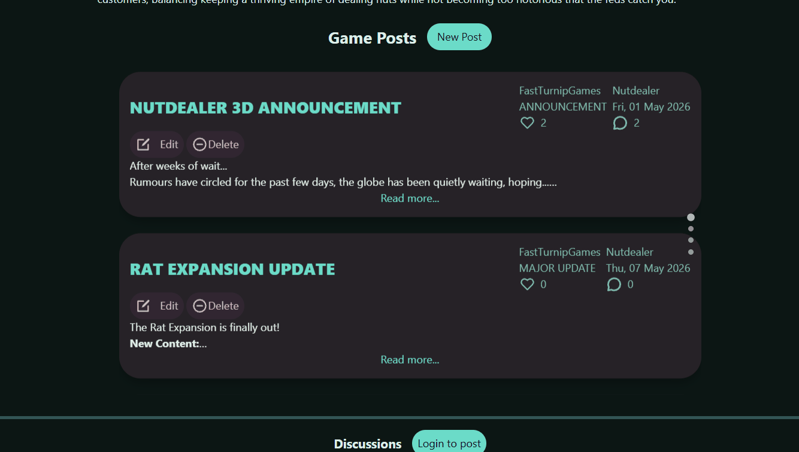

The second iteration of the post display was using a similar carousel to the screenshots, also using Splide library. This version uses a vertical slide display, that allows users to swipe through them separately, not taking up extra space but allowing users to scroll easily through as many posts as they need to.

End users agreed this was a much better version than the other two, and that it allowed much easier post navigation for games, while still making the rest of the page accessible without huge amounts of scrolling.

## Testing Post Comments

Currently on the post page, comments to posts fully display, with all nested replies below. End users commented that it was quite messy and cluttered, especially with a lot of replies. They suggested making it so users can show the replies if wanted, otherwise they are hidden.

Current comment display:

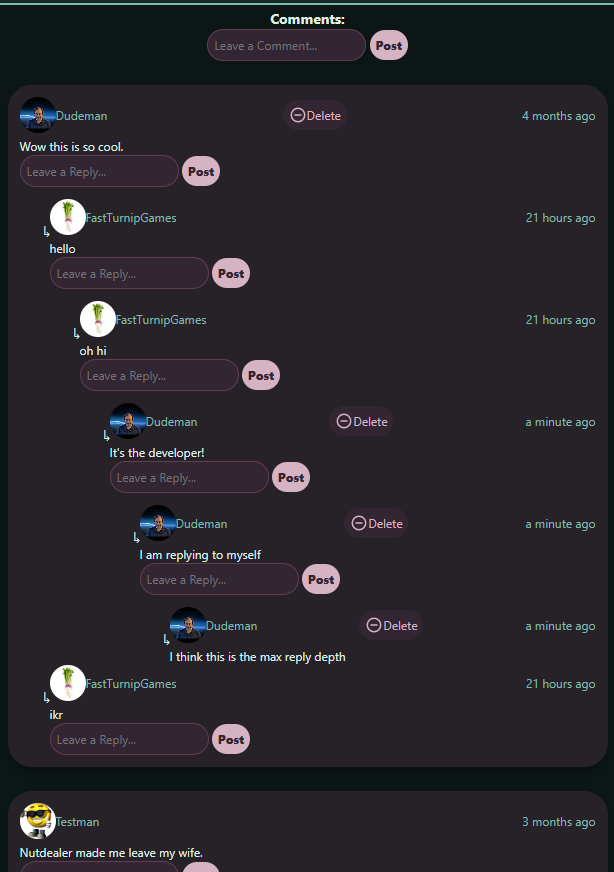

### Changes / Improvements

Replace this text with notes any improvements you made as a result of the testing.

**PLACE SCREENSHOTS AND/OR ANIMATED GIFS OF THE IMPROVED SYSTEM HERE**

## Testing Developer Users

Replace this text with notes about what you are testing, how you tested it, and the outcome of the testing

**PLACE SCREENSHOTS AND/OR ANIMATED GIFS OF THE TESTING HERE**

### Changes / Improvements

Replace this text with notes any improvements you made as a result of the testing.

**PLACE SCREENSHOTS AND/OR ANIMATED GIFS OF THE IMPROVED SYSTEM HERE**

## Testing User Experience with Interactions

Replace this text with notes about what you are testing, how you tested it, and the outcome of the testing

**PLACE SCREENSHOTS AND/OR ANIMATED GIFS OF THE TESTING HERE**

### Changes / Improvements

Replace this text with notes any improvements you made as a result of the testing.

**PLACE SCREENSHOTS AND/OR ANIMATED GIFS OF THE IMPROVED SYSTEM HERE**

## ETC...

## Sprint Review

Replace this text with a statement about how the sprint has moved the project forward - key success point, any things that didn't go so well, etc.

