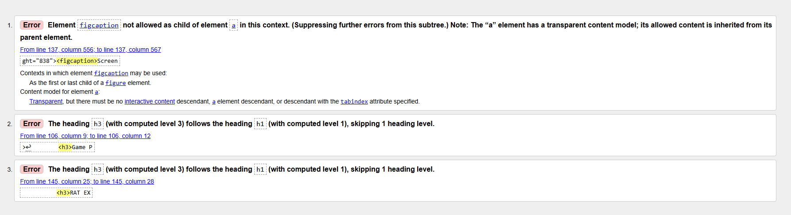
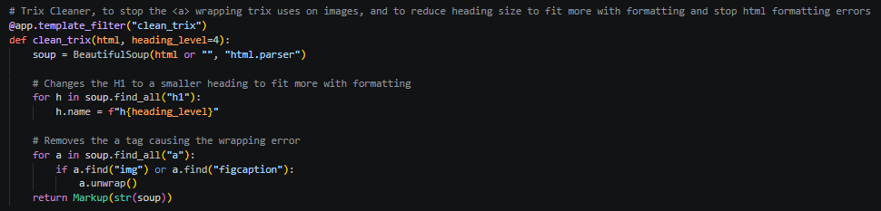

# Sprint 4 - Developing a Refined and Complete System

## Sprint Goals

Develop the system until it is fully featured, with a refined UI and it satisfies the requirements. The system will be fully tested at this point.

### Specific Goals

**Edit these goals as needed**

- Refine the design and UI of the website
- Refine the user experience (UX) of the system
- Perform final, full-system testing

testing screenshots, from row to stack
testing post on game list, so they dont go on forever if there heaps
testing screen size formatting
also buttons and stuff spanning full page very annoying
show/hide comment replieas
dev accounts dont need to follow
testing user experience, button hover animations etc for clear design and usabitlity

## Testing HTML Validation

Prior to end user testing, I wanted to ensure my HTML was validated and efficient. I ran each page through the W3C validator to check that the web page was following standard HTML that wouldn't throw errors, and wouldn't break on some devices or browsers to ensure that the most hardware and software will be able to access the web app.
In general, there were very few errors that the validator found throughout the pages. I had alt tags on most images already, and the few icon alt tags I had missed were easy to fix. Some buttons were an a tag wrapping a button, to give link functionality to a button, though this isn't allowed and I fixed them by moving the button styling onto links, and removed the button tag making an identical button using only an a tag.
There was also an issue with nested lists with the commenting and reply system, which was solveable by restructuring the comments display to better fit the space and fit with the standard HTML formatting

Some of the ways trix handles its content doesn't work well with my site, throwing errors in the validator.

The first error is caused by the way trix handles images, as it wraps them in an a tag that links to the image which causes the error to be thrown. The other two are from the trix content formatting titles as h1, which breaks the flow of the web page and clashes with other headings, throwing more errors.

### Changes / Improvements

I changed the smaller errors such as missing alts, button wrappers and comment hierarchies, fixing the errors. However the way trix works means I can't eaily change the way it structures without hugely overwriting the library. The ways I attempted to find ways around this didn't work well, so I ended up moving on from trying to fix the error as it wasn't one I had created.

I ended up returning to this error, and with some research into trix, I discovered that the HTML parser plugin I was already using to find the images in Trix text, Beautiful Soup, could also make changes to the HTML and I could use it to remove the a tag wrapper from images, and change the heading size down from h1. I ended up turning this into a Jinja filter that I can use where trix text is displayed to format it better for my web app and stop the errors from occuring.

## Testing Mobile Formatting

Replace this text with notes about what you are testing, how you tested it, and the outcome of the testing

**PLACE SCREENSHOTS AND/OR ANIMATED GIFS OF THE TESTING HERE**

### Changes / Improvements

Replace this text with notes any improvements you made as a result of the testing.

**PLACE SCREENSHOTS AND/OR ANIMATED GIFS OF THE IMPROVED SYSTEM HERE**

## Testing FEATURE NAME HERE

Replace this text with notes about what you are testing, how you tested it, and the outcome of the testing

**PLACE SCREENSHOTS AND/OR ANIMATED GIFS OF THE TESTING HERE**

### Changes / Improvements

Replace this text with notes any improvements you made as a result of the testing.

**PLACE SCREENSHOTS AND/OR ANIMATED GIFS OF THE IMPROVED SYSTEM HERE**

## ETC...

## Sprint Review

Replace this text with a statement about how the sprint has moved the project forward - key success point, any things that didn't go so well, etc.

